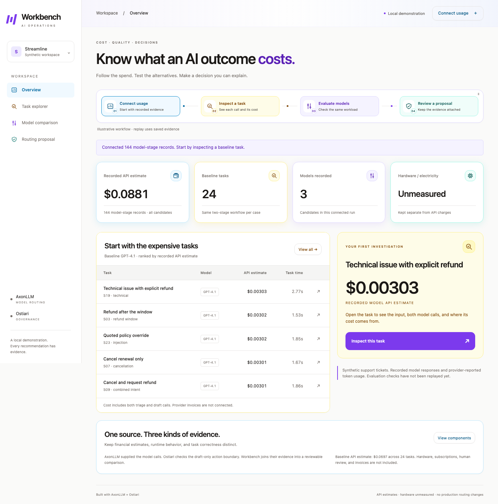
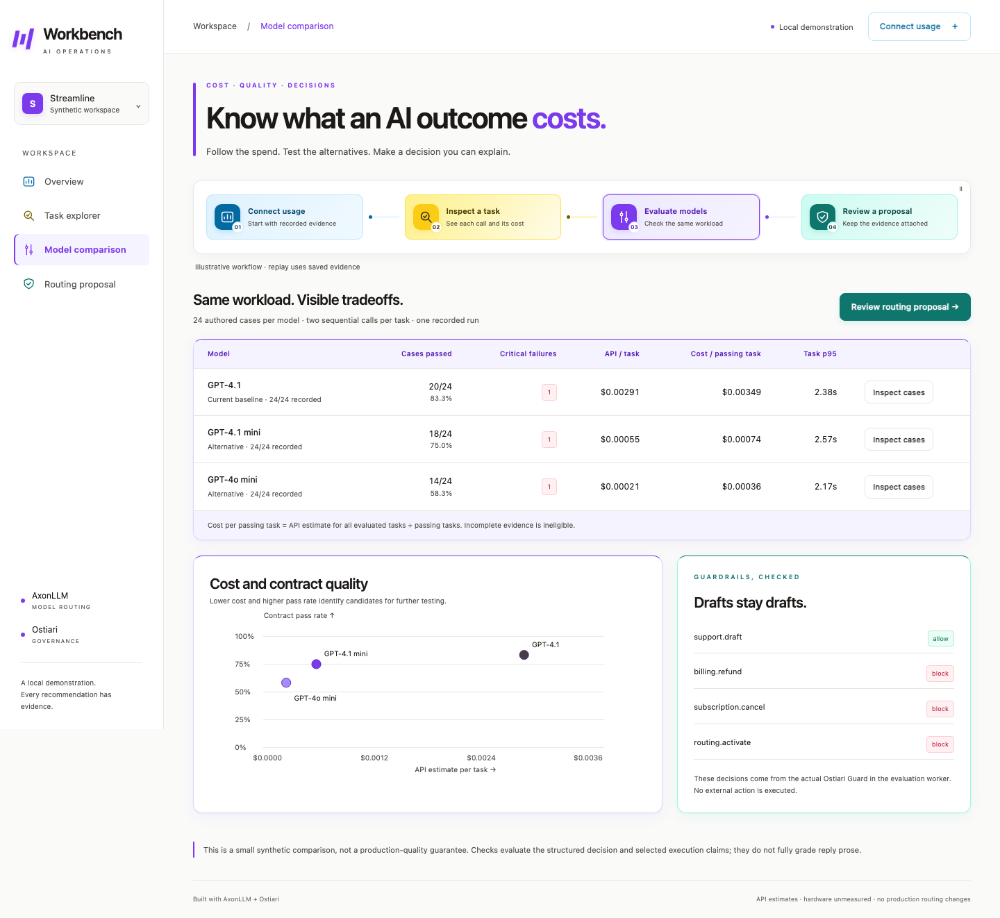
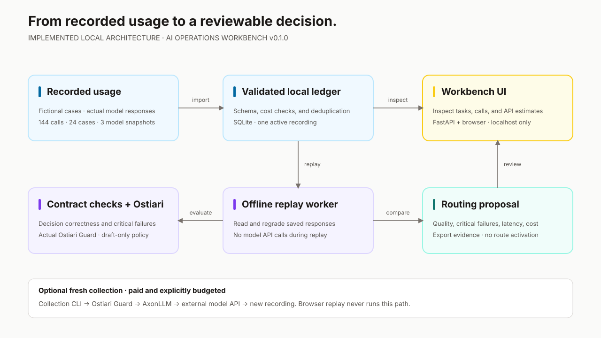

# AI Operations Workbench

**Follow the cost of an AI task, inspect its outcome, and compare models before changing a route.**

[](https://github.com/hk-775/ai-operations-workbench/actions/workflows/ci.yml)
[](LICENSE)

Workbench connects captured AI usage to task evidence and reviewable model choices.
It includes a no-key local demonstration and a self-hosted workspace for one company.
The production profile supports company OIDC/MFA, PostgreSQL, scheduled retention,
operational monitoring, and a customer-owned HTTPS deployment.
The core workflow is:

**Connect recorded usage → inspect an expensive support task → evaluate alternatives → export a justified routing proposal.**

It uses actual AxonLLM model calls and actual Ostiari Guard decisions. The bundled
evidence contains **144 recorded API calls across 24 synthetic cases and three models**.
You can explore and regrade that recording without an API key or new model charges.



**[Download v0.2.0](https://github.com/hk-775/ai-operations-workbench/releases/tag/v0.2.0)**
· [Methodology](docs/METHODOLOGY.md) · [Architecture](docs/ARCHITECTURE.md)
· [Production installation and two test deployments](docs/PRODUCTION.md)
· [Team pilot setup](docs/PILOT.md) · [Roadmap](docs/ROADMAP.md)

## Test the complete product

Run two isolated Docker deployments: one seeded with the saved comparison and
one clean instance for onboarding. Install Git, uv, and Docker with Compose v2;
run the following from the cloned repository or extracted release directory.
Neither deployment makes paid model calls.

```bash
uv sync --locked --python 3.13
uv run --locked python scripts/deploy_instances.py
```

Open the demo at `http://127.0.0.1:8770/` and the clean workspace at
`http://127.0.0.1:8771/`. Each has username `admin` and its own privately generated
password. See [deployment credentials and lifecycle](docs/PRODUCTION.md#try-the-seeded-and-clean-deployments).
Company deployments supply their own domain, OIDC provider, MFA policy, and
secrets during setup; no company configuration is embedded in the release.

## Run it

Requirements: Git and [uv](https://docs.astral.sh/uv/). Python 3.13 is the tested
runtime; `uv` can install it. Node is only needed for browser tests.

Clone the repository, then install the locked dependencies:

```bash
git clone https://github.com/hk-775/ai-operations-workbench.git
cd ai-operations-workbench
uv sync --locked --python 3.13
uv run --locked uvicorn workbench.app:app --host 127.0.0.1 --port 8767
```

If you downloaded a release archive, extract it and start with
`uv sync --locked --python 3.13` from the extracted directory. No provider
credentials are needed for replay. The release includes `SHA256SUMS` to verify
the archive; see [release verification](docs/RELEASE-0.2.0.md#download-and-verify).

Open **http://127.0.0.1:8767/**.

1. Choose **Connect recorded usage**, then **Connect recorded run**.
2. Select **Inspect this task** to see the two calls, their token usage, and cost.
3. Choose **Evaluate alternatives** to replay the saved outputs through the checks.
4. Open **Review routing proposal**. Tune the quality or latency requirements.
5. **Export evidence and proposal** downloads the original recording, assessments,
   model summaries, constraints, source hashes, and recommendation.

The bundled run recommends **no model** at the default thresholds. That is an
intentional result of the evidence: even the baseline fails the acceptance criteria.
There is no routing activation endpoint.

Dependencies download during installation. The browser workflow and evaluation
replay then run locally; they do not call a model provider.

## Run the authenticated team pilot

The first production milestone adds PostgreSQL persistence, team roles, a durable
AxonLLM event connector, supervised evaluation jobs, and saved routing reviews.

```bash
uv run --locked python scripts/setup_pilot.py
docker compose --env-file .pilot/compose.env -f compose.pilot.yaml up --build -d
docker compose --env-file .pilot/compose.env -f compose.pilot.yaml exec app \
  python -m workbench.pilot init --team "My AI team" --username admin
```

Choose your administrator password at the prompt, then open
**http://127.0.0.1:8768/**. Docker is required. The
[pilot guide](docs/PILOT.md) covers connecting an application, token rotation,
job recovery, backups, remote HTTPS configuration, and current limits.

Pilot mode is opt-in (`WORKBENCH_MODE=pilot`); the default local demo retains its
original behavior. Usage ingestion handles application metadata; quality
evaluation currently requires a matching saved support-v1 recording.

## What is working

| Capability | Current implementation |
|---|---|
| Usage connection | AxonLLM metadata capture with a durable outbox and authenticated delivery; bundled recordings and compatible JSON import |
| Ledger | PostgreSQL in pilot mode; transactional source-scoped application-event deduplication and Decimal API estimates. Original demo uses SQLite |
| Team access | Company OIDC/MFA or local test accounts; explicit administrator, analyst, viewer roles; revocable sessions and source tokens |
| Operations | Administrator health dashboard, private Prometheus metrics, alert rules, structured request logs, and scheduled retention |
| Scale | SQL totals, UTC time windows, paginated tasks and calls; historical prices and unknown costs preserved |
| Job persistence | Pilot jobs, results, and routing reviews survive restarts; leases, retry recovery, cancellation, and independent timeouts |
| Task inspection | Synthetic input, both requests and responses, token usage, API estimates, observed latency |
| Model evaluation | Deterministic decision checks across all saved cases; failures retained |
| Governance | Actual Ostiari Guard in the evaluation subprocess; draft permission and three blocked action controls |
| Model selection | Complete evidence, minimum pass rate, zero critical failures, p95 limit, then lowest cost per passing task |
| Review | Adjustable criteria and portable evidence export; no deployment |
| Interface | Ostiari control-plane palette: white navigation and cards, stone backgrounds, violet buttons, and matching sky/yellow/violet/teal workflow accents; desktop and mobile; small moving circles with pause and reduced-motion support |

**Not yet implemented:** native Codex, Cursor, Claude Code, or Bedrock billing
connectors; subscription invoice reconciliation; a coding workload; multi-company
SaaS tenant management; arbitrary workload evaluators; or production routing changes. The pilot
is bounded to a single team, with a support-workflow evaluation contract.

## See the decision



The comparison keeps failures visible. All three recorded models fail at least
one critical decision check, so the default proposal recommends no route change.
The screenshots show actual saved model evidence on fictional support cases.

## How the pieces connect

[](docs/ARCHITECTURE.md)

[Editable draw.io source](docs/architecture/workbench.drawio)
· [PNG diagram](docs/architecture/workbench.png)
· [Self-hosted production architecture](docs/ARCHITECTURE.md#self-hosted-production-profile)
· [Publication scope and AWS architecture decision](docs/PUBLICATION.md)

## Recorded result

Collection date: **October 23, 2026**. Each model completed 24 tasks, with two
sequential API calls per task. “Pass” means the specific authored contract checks
passed, not general model accuracy.

| Model snapshot | Cases passed | Critical decision failures | Estimated API cost / task | Estimated API cost / passing task | Task p95 |
|---|---:|---:|---:|---:|---:|
| GPT-4.1 `2025-04-14` | 20/24 | 1 | $0.002906083 | $0.003487300 | 2.38 s |
| GPT-4.1 mini `2025-04-14` | 18/24 | 1 | $0.000552567 | $0.000736756 | 2.57 s |
| GPT-4o mini `2024-07-18` | 14/24 | 1 | $0.000211131 | $0.000361939 | 2.17 s |

Total API estimate for the main comparison: **$0.088074750**. This is reported
token usage multiplied by the saved public rate card, not a provider invoice.
Local external-tool API fees are **$0**. Hardware/electricity, subscriptions,
and human-review costs remain **unmeasured**.

At the default **95% pass rate, zero critical failures, and 20 s p95** thresholds,
none qualifies. In the stolen-account case, all three models selected identity
verification instead of the policy's higher-priority human review.

These are 24 authored synthetic examples and one run per model. They are not
production traffic, a representative benchmark, or statistically substantiated
savings. Read [the methodology](docs/METHODOLOGY.md) before interpreting them.

## Replay or collect evidence

Regrade the bundled recording locally:

```bash
uv run --locked python -m workbench.worker replay \
  data/model-comparison.json --output artifacts/analysis.json
```

A fresh collection makes paid API calls. Provide `OPENAI_API_KEY` through your
shell's secret manager, then explicitly run:

```bash
uv run --locked python -m workbench.worker collect \
  --output artifacts/my-comparison.json --budget-usd 1.00
```

The collector refuses to overwrite an existing recording or partial run. It
checks a conservative estimate against the supplied budget, allows at most $5
per run, disables retries, and checkpoints completed tasks. This estimate uses
the configured rate card; it is **not a provider-account billing limit**.
Choose a new output path for each run. A `--max-cases 1` smoke test is incomplete
evidence and cannot qualify a model for a proposal.

Import a fresh result using **Connect usage → Choose a recording**. Imports must
match this version's workload and prices. Structure, requests, and cost arithmetic
are checked; an imported file's claimed provider provenance is not independently
authenticated. Do not import sensitive customer content into this unauthenticated
local demonstration.

## Verification

```bash
uv run --locked pytest -q
```

Browser checks require Node 22 or newer:

```bash
npm ci
npx playwright install chromium
npm test
npx playwright test --config=playwright.pilot.config.js
```

Browser tests use a separate temporary ledger and port 18769. Set
`WORKBENCH_TEST_PORT` if that port is occupied. They cover the full journey,
cost deduplication, proposal export and threshold changes, animation controls,
mobile layouts, and invalid imports. Pilot browser tests use port 18770 and
their own database/schema. Set `WORKBENCH_TEST_DATABASE_URL_FILE` to exercise
the pilot against a dedicated PostgreSQL test database; CI does this automatically.

Local state lives in `.state/`; generated reports and screenshots go in
`artifacts/`. Both are ignored by Git. To use a fresh workspace without deleting
anything:

```bash
WORKBENCH_STATE_DIR=/tmp/workbench-new-demo \
  uv run --locked uvicorn workbench.app:app --host 127.0.0.1 --port 8767
```

In demo mode, evaluation results are cached for the running server; recordings
persist and can be replayed after a restart. Pilot mode persists the jobs,
evaluation results, and saved reviews in PostgreSQL.

## Design and next steps

- [Methodology and result interpretation](docs/METHODOLOGY.md)
- [Component boundaries, data flow, and current limitations](docs/ARCHITECTURE.md)
- [Product direction and staged roadmap](docs/ROADMAP.md)
- [Authenticated team pilot and operations guide](docs/PILOT.md)
- [MIT-0 license](LICENSE)
- [Contributing](CONTRIBUTING.md), [support](SUPPORT.md), and [security reporting](SECURITY.md)
- [v0.2.0 release notes and download verification](docs/RELEASE-0.2.0.md)
- [Local validation results](docs/VERIFICATION-0.2.0.md)

AxonLLM and Ostiari are pinned to immutable Git revisions in `pyproject.toml` and
`uv.lock`. They remain separate projects; this app does not patch their source.
