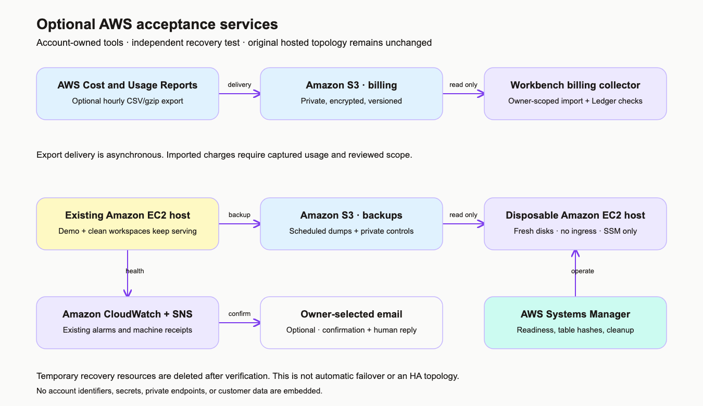

# Billing delivery and independent host recovery

These optional tools extend the hosted test without modifying the two running
workspaces. They are account-owned acceptance infrastructure, not a highly
available production deployment or a customer certification.



[Editable draw.io source](architecture/aws-acceptance.drawio).

## Provision a private billing export

`deploy/aws/billing-export.json` creates a dedicated private, encrypted, versioned
S3 bucket and a Legacy CUR report with hourly CSV/gzip rows and new report
versions. Deploy the report definition in `us-east-1`. The format matches the
existing [scheduled collector](BILLING-COLLECTION.md); CUR 2.0/Parquet requires
a separately validated adapter.

```sh
uv sync --locked
uv run --locked python deploy/aws/build_acceptance_templates.py
cfn-lint --regions us-east-1 --template deploy/aws/billing-export.json
cfn-guard validate --data deploy/aws/billing-export.json \
  --rules deploy/aws/acceptance.guard
aws cloudformation create-change-set \
  --region us-east-1 --stack-name workbench-billing \
  --change-set-name reviewed-billing --change-set-type CREATE \
  --template-body file://deploy/aws/billing-export.json
```

Inspect the change set and AWS validation events, then execute it in the intended
account. The only new resources are the report, its bucket, and its bucket policy.
The documented CUR service policy permits bucket ownership checks and delivery,
restricted to this account's billing service. Delivery verification also needs
write permission at the bucket root, so the bucket is dedicated to billing.
Other access requires the operator's own IAM permission.

AWS documents that first delivery can take **up to 24 hours**, with updates at
least daily afterward. Provisioning success is not delivery success. See
[AWS report creation](https://docs.aws.amazon.com/cur/latest/userguide/cur-create.html)
and [AWS bucket policy](https://docs.aws.amazon.com/cur/latest/userguide/cur-s3.html).
S3 storage and requests incur normal AWS charges.

After delivery, configure the collector with the actual bucket, account, month,
team UUID, and monthly manifest key. Run its dry-run first. Preserve the full
assembly, independently captured usage, and owner-reviewed controls for
[real billing acceptance](BILLING-ACCEPTANCE.md). Current-month data can change;
uncaptured account usage remains unassigned or incomplete, rather than becoming
a fabricated per-task bill.

The bucket is retained when its stack is deleted. Stop unwanted recurring
delivery by deleting the report/stack, then apply the organization's billing
retention policy to the retained bucket.

## Recover onto a separate host

`deploy/aws/recovery-drill.json` provisions a new EC2 instance, encrypted
disposable disk, dedicated security group with **no ingress**, and an SSM role.
Its role can read the original backups and this drill's bootstrap prefix, and
write only drill receipts. It cannot overwrite backup pointers or publish the
source deployment's monitoring metrics.

Supply private CloudFormation parameters for the existing VPC/subnet, a reviewed
Amazon Linux x86 AMI, the backup bucket, and a unique
`bootstrap/recovery-<id>/` prefix. Use a subnet with working outbound AWS,
package-registry and container-registry access. Review/execute a CREATE change
set with `CAPABILITY_IAM`; preserve the original instance and security group.

The instance uses standard CPU credits, automatically shuts down with termination
after two hours, and deletes its new disk on termination. Explicitly delete the
stack after the drill so the instance profile, role, and security group are also
removed. Do not rely on termination alone as complete cleanup.

The host procedure is `deploy/aws/recovery_host.py`, run as the dedicated
`workbench` user via SSM:

1. **Prepare on the source host.** `prepare` freezes the current scheduled backup
   receipts, verifies dump hashes, restores each dump into a temporary control
   database, and records counts and hashes for all application tables. Temporary
   control databases are removed. It uploads a private encrypted bundle of the
   minimum runtime configuration and controls to the dedicated bootstrap prefix.
2. **Pin the release.** Download the published source archive, verify its
   `SHA256SUMS`, and place it at `<prefix>source.tar.gz`. Independently verify the
   recovery helper before executing it. No private runtime files belong in the
   source archive.
3. **Wait for bootstrap.** CloudFormation completion and SSM registration can
   precede package installation. Verify `/opt/workbench/bootstrap-ready` before
   starting the restore.
4. **Restore on the new host.** `restore` requires the source and input checksums,
   refuses existing workspace directories and the source machine identity, and
   restores to fresh database volumes. It compares every table before workers
   start, checks production configuration, starts the services, and checks local
   HTTP readiness and authentication boundaries.
5. **Preserve and clean up.** Download `<prefix>evidence/result.json`, verify its
   success and scope, then delete the disposable stack and private bootstrap
   objects. The original backups and running workspaces remain intact.

Example host arguments, with operator-owned values:

```sh
python3 recovery_host.py prepare \
  --region us-east-1 --bucket YOUR_BACKUP_BUCKET \
  --prefix bootstrap/recovery-UNIQUE_ID/
python3 recovery_host.py restore \
  --region us-east-1 --bucket YOUR_BACKUP_BUCKET \
  --prefix bootstrap/recovery-UNIQUE_ID/ \
  --input-sha256 VERIFIED_INPUT_SHA256 \
  --source-sha256 VERIFIED_RELEASE_SHA256
```

Use lowercase letters/numbers/hyphens for the actual unique ID. These commands
run on the prepared AWS hosts; the host helper uses the installed Python/CLI.
Application images are built with the release's pinned `uv.lock`.

The receipt proves private recovery on independent compute and storage. It does
**not** claim a DNS cutover, new interactive SSO acceptance, automatic failover,
or an agreed customer RTO/RPO. It reports elapsed time and backup age for review.
The password-only hosted-test exception remains explicit; normal production
still requires verified MFA.

## Human alert acceptance

The existing encrypted SNS topic and receipt queue prove machine delivery.
Email acceptance additionally requires an owner-selected address, confirmation
of its SNS subscription, a controlled notification, and the recipient's actual
acknowledgment. A successful publish or queue message cannot establish that a
person received and understood the alert.
