# Component boundaries

Workbench owns the local interface, usage ledger, evidence validation, comparison,
and proposal. Existing projects provide the model routing and governance engines.

[Edit in draw.io](architecture/workbench.drawio) · [Download PNG](architecture/workbench.png)

The diagram describes the current workstation application. No AWS infrastructure
or remote hosting is deployed by this repository; see the
[publication architecture decision](PUBLICATION.md#aws-services-reference-architecture-not-applicable-to-v010).

```mermaid
flowchart LR
    CLI["Explicit collection CLI"] --> Guard["Ostiari Guard"]
    Guard --> Axon["AxonLLM AsyncRouter"]
    Axon --> API["Model API"]
    API --> Recording["Recorded requests, responses, usage, latency"]
    Recording --> Import["Validated, idempotent import"]
    Import --> DB[("Workbench SQLite ledger")]
    DB --> UI["Local dashboard"]
    DB --> Worker["Managed offline evaluation worker"]
    Worker --> Checks["Contract checks + Ostiari controls"]
    Checks --> Proposal["Evidence-backed proposal"]
    Proposal --> UI
    UI --> Export["Portable JSON evidence"]
```

## Reuse

**AxonLLM:** the collector calls its public router. AxonLLM handles the model
provider invocation and normalized usage response. This version uses explicit
model snapshot selection to compare like-for-like tasks.

**Ostiari:** the collector and replay worker instantiate the actual Guard package,
load the configured policy, and use a temporary SQLite trace store. The worker
exports validation decisions and cleans up its temporary storage.

**Workbench:** the FastAPI process serves the static UI and its local JSON API.
It maintains the import ledger and launches offline evaluation subprocesses.
Its recommendation logic combines correctness, critical failures, latency, and
cost estimates.

This version embeds **Ostiari Guard**, not Ostiari's complete gateway/control
plane. It does not exercise Ostiari's billing dashboard, identity, approvals,
or full trace retention. AxonLLM Ledger is a possible later source for billing
ingestion; it is not integrated here.

Dependencies are pinned to immutable upstream Git commits. There are no changes
to the AxonLLM, Ostiari, or Ledger repositories.

## Local API

| Endpoint | Purpose |
|---|---|
| `GET /api/state` | Active recording and baseline task/cost view |
| `POST /api/connect` | Import the bundled recording |
| `POST /api/import` | Validate and import compatible recording JSON |
| `POST /api/evaluate` | Start a subprocess to replay the saved evidence |
| `GET /api/jobs/{id}` | Inspect replay status and collect the report |
| `GET /api/analysis` | Read the active run's completed analysis |
| `POST /api/recommend` | Evaluate a set of quality/latency/volume constraints |
| `GET /api/recording` | Download the active evidence file |
| `GET /api/integrations` | Identify actual installed components and missing connectors |

No endpoint collects live model responses or activates a route. Collection
requires the separate CLI and an explicit budget.

## Evidence integrity and ledger behavior

The recording contract binds the case corpus, policy, prompts, and rate card.
Imports reconstruct expected requests, verify stage order, check reported
token arithmetic and latency consistency, reject duplicate model/case samples,
and reject duplicate provider response IDs within a file.

The ledger stores recordings, individual stage events, and the active recording
selection. The recording's canonical JSON hash is its ID. Provider response IDs
deduplicate overlapping imports; a changed payload for an existing event ID
rejects and rolls back the import.

Without provider IDs, fallback deduplication only applies to the same recording
identity. Imported provider IDs and provenance are self-reported; these checks
establish internal consistency, not an authenticated link to a provider invoice.

The dashboard displays the **active recording**. The underlying ledger may hold
several imported runs, but the app does not present historical organization-wide
aggregation or sum all those runs into a company's bill.

Replay exports code/configuration/lock hashes separately from the recording
contract. This preserves the distinction between original inference and later
grading. Fixture mode is explicitly marked in the UI and proposal limitations.

## Local access and lifecycle

Run the server bound to `127.0.0.1`. The middleware limits accepted hostnames,
rejects cross-origin requests, requires JSON writes, limits import size, and
sets a content-security policy. Ticket text and responses are escaped before
browser rendering. The UI has no third-party scripts or analytics.

Offline workers do not receive credential variables whose names contain
`KEY`, `TOKEN`, `SECRET`, `PASSWORD`, or `CREDENTIAL`. Replay never initializes
the model router. This is not a network sandbox or a comprehensive credential
isolation boundary.

Workers are terminated when the server shuts down. Status polling enforces a
90-second replay limit. The persistent SQLite ledger stays in `.state/`, or the
directory specified by `WORKBENCH_STATE_DIR`; worker reports are in its `jobs/`
subdirectory. Analysis is cached in memory for the running server.

There is no authentication, tenant isolation, remote ingestion service, RBAC,
encrypted database, or distributed job queue. Treat this as a local demonstration.
A deployment for real customer data requires a separate design for those
capabilities.
