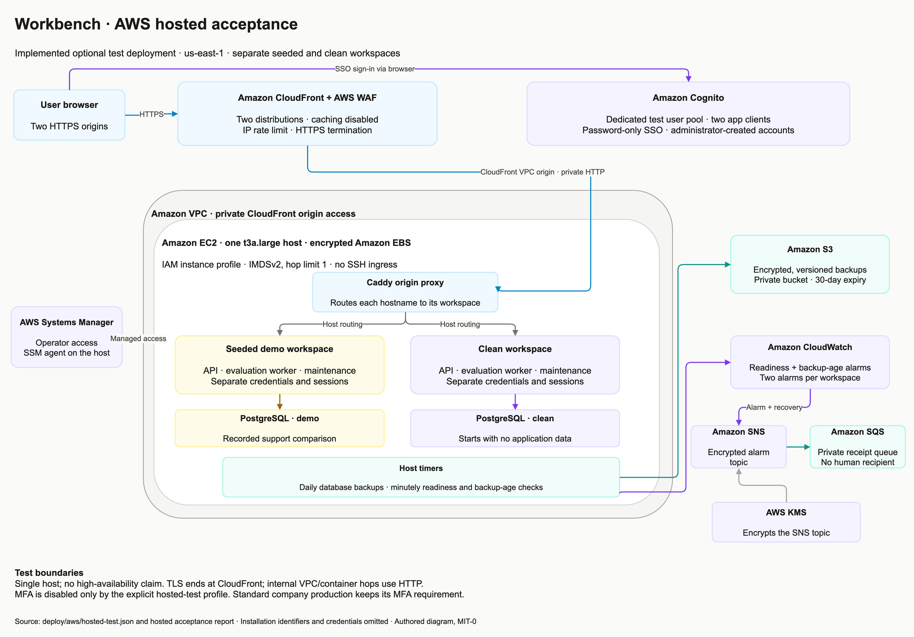
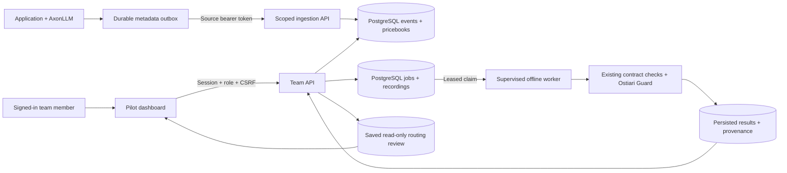
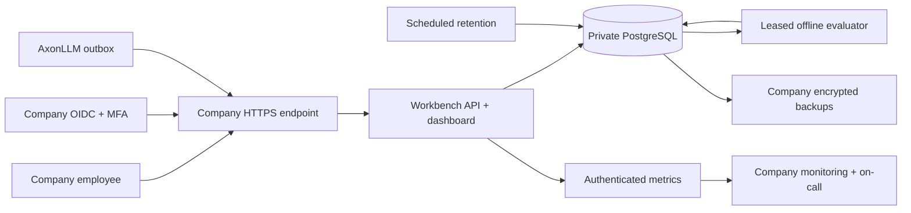

# Component boundaries

Workbench owns the interface, usage ledger, evidence validation, comparison,
and proposal. Existing projects provide the model routing and governance engines.

Open **Interactive architecture** from either dashboard's footer, or open
`/static/architecture.html` on the running application. The
[standalone page](../web/architecture.html) also works directly from the downloaded
source with its adjacent CSS and JavaScript files. It offers product and AWS
views, component explanations, step-by-step flows, moving solid circles,
pause/resume, and reduced-motion support. It makes no API or cloud requests;
motion illustrates architecture rather than live traffic.

The first sections and existing draw.io diagram below describe the original demo.
The [authenticated pilot](#authenticated-team-pilot) and
[self-hosted production profile](#self-hosted-production-profile) are documented
separately. Team mode is explicitly selected with `WORKBENCH_MODE=pilot`.

[Edit in draw.io](architecture/workbench.drawio) · [Download PNG](architecture/workbench.png)

The diagram above describes the original workstation application. The optional
[AWS hosted acceptance topology](#aws-hosted-acceptance) is a separate deployment
added on `main` after the v0.2.0 release.

## AWS hosted acceptance

[Edit the AWS diagram in draw.io](architecture/aws-hosted-test.drawio).
The topology is defined in `deploy/aws/hosted-test.json` and was exercised by the
[dated hosted acceptance run](VERIFICATION-HOSTED-2026-10-26.md).
It shows company-neutral service boundaries; installation identifiers are private.
This is an opt-in single-host test with password-only SSO, separate demo/clean
databases, private origin access, scheduled S3 backups, and CloudWatch/SNS/SQS
alert delivery. Human on-call delivery and high availability are not configured.
See [the hosted installation guide](HOSTED-TEST.md) for its internal HTTP hops,
backup retention, IAM boundaries, and recovery limits.

## Original local replay flow

```mermaid
flowchart LR
    CLI["Explicit collection CLI"] --> Guard["Ostiari Guard"]
    Guard --> Axon["AxonLLM AsyncRouter"]
    Axon --> API["Model API"]
    API --> Recording["Recorded requests, responses, usage, latency"]
    Recording --> Import["Validated, idempotent import"]
    Import --> DB[("Workbench SQLite ledger")]
    DB --> UI["Local dashboard"]
    DB --> Worker["Managed offline evaluation worker"]
    Worker --> Checks["Contract checks + Ostiari controls"]
    Checks --> Proposal["Evidence-backed proposal"]
    Proposal --> UI
    UI --> Export["Portable JSON evidence"]
```

## Reuse

**AxonLLM:** the collector calls its public router. AxonLLM handles the model
provider invocation and normalized usage response. This version uses explicit
model snapshot selection to compare like-for-like tasks.

**Ostiari:** the collector and replay worker instantiate the actual Guard package,
load the configured policy, and use a temporary SQLite trace store. The worker
exports validation decisions and cleans up its temporary storage.

**Workbench:** the FastAPI process serves the static UI and its local JSON API.
It maintains the import ledger and launches offline evaluation subprocesses.
Its recommendation logic combines correctness, critical failures, latency, and
cost estimates.

This version embeds **Ostiari Guard**, not Ostiari's complete gateway/control
plane. It does not exercise Ostiari's billing dashboard, identity, approvals,
or full trace retention. AxonLLM Ledger is a possible later source for billing
ingestion; it is not integrated here.

Dependencies are pinned to immutable upstream Git commits. There are no changes
to the AxonLLM, Ostiari, or Ledger repositories.

## Local API

| Endpoint | Purpose |
|---|---|
| `GET /api/state` | Active recording and baseline task/cost view |
| `POST /api/connect` | Import the bundled recording |
| `POST /api/import` | Validate and import compatible recording JSON |
| `POST /api/evaluate` | Start a subprocess to replay the saved evidence |
| `GET /api/jobs/{id}` | Inspect replay status and collect the report |
| `GET /api/analysis` | Read the active run's completed analysis |
| `POST /api/recommend` | Evaluate a set of quality/latency/volume constraints |
| `GET /api/recording` | Download the active evidence file |
| `GET /api/integrations` | Identify actual installed components and missing connectors |

No endpoint collects live model responses or activates a route. Collection
requires the separate CLI and an explicit budget.

## Evidence integrity and ledger behavior

The recording contract binds the case corpus, policy, prompts, and rate card.
Imports reconstruct expected requests, verify stage order, check reported
token arithmetic and latency consistency, reject duplicate model/case samples,
and reject duplicate provider response IDs within a file.

The ledger stores recordings, individual stage events, and the active recording
selection. The recording's canonical JSON hash is its ID. Provider response IDs
deduplicate overlapping imports; a changed payload for an existing event ID
rejects and rolls back the import.

Without provider IDs, fallback deduplication only applies to the same recording
identity. Imported provider IDs and provenance are self-reported; these checks
establish internal consistency, not an authenticated link to a provider invoice.

The dashboard displays the **active recording**. The underlying ledger may hold
several imported runs, but the app does not present historical organization-wide
aggregation or sum all those runs into a company's bill.

Replay exports code/configuration/lock hashes separately from the recording
contract. This preserves the distinction between original inference and later
grading. Fixture mode is explicitly marked in the UI and proposal limitations.

## Local access and lifecycle

Run the server bound to `127.0.0.1`. The middleware limits accepted hostnames,
rejects cross-origin requests, requires JSON writes, limits import size, and
sets a content-security policy. Ticket text and responses are escaped before
browser rendering. The UI has no third-party scripts or analytics.

Offline workers do not receive credential variables whose names contain
`KEY`, `TOKEN`, `SECRET`, `PASSWORD`, or `CREDENTIAL`. Replay never initializes
the model router. This is not a network sandbox or a comprehensive credential
isolation boundary.

Workers are terminated when the server shuts down. Status polling enforces a
90-second replay limit. The persistent SQLite ledger stays in `.state/`, or the
directory specified by `WORKBENCH_STATE_DIR`; worker reports are in its `jobs/`
subdirectory. Analysis is cached in memory for the running server.

The original demo has no authentication, tenant isolation, remote ingestion service, RBAC,
encrypted database, or distributed job queue. Treat this as a local demonstration.
A deployment for real customer data requires a separate design for those
capabilities.

## Authenticated team pilot

Each connector source owns its application event IDs. Repeated provider response
IDs are allowed. Duplicate events are acknowledged; conflicting payloads roll
back the entire batch. The connector verifies its source identity before delivery
and keeps unacknowledged events for retries. The API recomputes Decimal estimates
from an immutable pricebook and preserves unknown usage/attempt coverage.

The worker process outlives browser/API sessions, claims jobs with PostgreSQL row
locks, and supervises a subprocess with a fixed timeout. Expired leases can be
recovered; ownership fencing rejects stale results. The original recording,
evaluator revision, result, and review criteria remain stored after restarts.
Changing the evaluator revision requires a new replay for a new review.

The pilot API has no demo routes, live model collection endpoint, or routing
activation endpoint. Usage metadata is separate from the support-v1 recordings
required for quality evaluation. The app uses a nonsuperuser database role.
This stack deploys no AWS infrastructure. See the [pilot guide](PILOT.md) for
roles, credentials, event semantics, data limits, and deployment/restore steps.

## Self-hosted production profile

Each company owns an independent stack. Login maps verified issuer/subject pairs
to explicit Workbench roles. Production accepts only sessions issued through the
verified OIDC/MFA path. The source release contains no company domain or credentials.
The API and maintenance scheduler share durable state; SQL aggregates preserve
historical pricing while returning bounded task and call pages.

The runtime image contains the application, locked dependencies, and evaluator
provenance files. Git, uv, and Python package installers stay outside the runtime
image. An explicit schema migration precedes production startup.

The local test profile creates separate demo and clean volumes, users, database
secrets, and browser cookie names. Demo seeding imports the same bundled saved
evidence and runs the real offline evaluator. The clean profile imports nothing.
See [production deployment](PRODUCTION.md) for the installer and operational checks.
