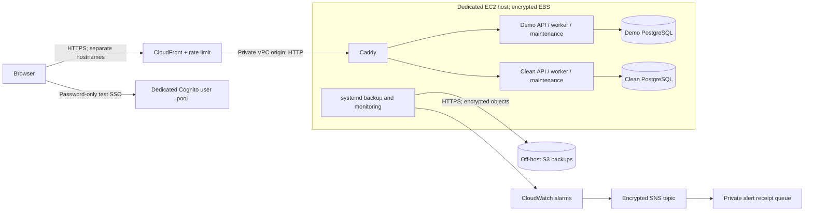

# Hosted acceptance test on AWS

This opt-in deployment verifies the self-hosted application on a real server.
It has two independent workspaces: a recorded demo and a clean installation.
It uses fictional content, makes no paid model calls, and changes no routing.
The [October 26 acceptance report](VERIFICATION-HOSTED-2026-10-26.md) records
the completed hosted verification and its limits.
The [October 28 billing acceptance](VERIFICATION-HOSTED-BILLING.md) records the
existing workspaces' upgrade to 0.5.0 source and schema 4, preserved data, billing
checks, and fresh backup restoration. The public v0.4.0 archive is unchanged.

The requested test uses **password-only Amazon Cognito SSO, without MFA**.
`WORKBENCH_HOSTED_TEST=true` makes this exception explicit. Standard production
configuration still requires a verified MFA claim. Successful tests here do not
constitute production MFA acceptance.

## Architecture



Only CloudFront's origin network can enter the host; SSH is closed. CloudFront
uses its private VPC-origin network. HTTPS ends at CloudFront; traffic within
the VPC and host uses HTTP. An installation requiring TLS on every internal hop
must supply the corresponding origin certificates and HTTPS configuration.
The host has internet egress for public dependencies and AWS service APIs.
Instance metadata requires IMDSv2 with hop limit 1, so application containers
cannot access the host's AWS role.

The demo and clean applications have separate databases, Docker projects,
credentials, Cognito clients, hostnames, and browser cookie namespaces.
The dedicated test pool permits administrator-created users only. Workbench
links exact issuer/subject identities and retains its explicit local roles.

## Provision and configure

`deploy/aws/build_template.py` generates the company-neutral
`deploy/aws/hosted-test.json`. Supply the account's VPC, subnet, current Amazon
Linux 2023 x86 AMI, and CloudFront origin managed prefix list as parameters.
The CloudFront-scoped WAF configuration requires deploying this reference stack
in `us-east-1`. Validate with cfn-lint and `deploy/aws/hosted.guard`, inspect a
CloudFormation change set, and then execute it.

The stack creates a dedicated t3a.large host, two HTTPS distributions, a test
identity provider, encrypted off-host storage, and monitoring. It does not alter
existing applications. Compute, storage, public IPv4, WAF, monitoring, encryption
keys, and traffic can incur AWS charges.

Runtime setup uses a private JSON bootstrap document containing stack outputs,
separate generated OIDC client secrets, and explicitly created test subjects.
Keep it outside Git and remove temporary bootstrap objects after installation.
Do not put secret values in CloudFormation parameters, SSM command text, logs,
issues, screenshots, or terminal output.

1. Copy the same verified source into `/opt/workbench/demo` and
   `/opt/workbench/clean` on the dedicated host.
2. As the unprivileged `workbench` account, run
   `deploy/aws/configure_host.py --bootstrap PRIVATE_FILE`.
3. Run `deploy/aws/start_host.py` as that account. It builds one shared set of
   images, migrates each database, provisions the linked administrator, seeds
   only the demo, and starts API, worker, maintenance, and the private origin.
4. Run `deploy/aws/install_timers.sh` as root. Its initial scheduled backup runs
   shortly after activation; subsequent backups run daily at 03:00 UTC.
5. Verify actual sign-in, anonymous access boundaries, seeded/empty content,
   scheduled backup, restore, outage alert delivery, and recovery.

The setup refuses to replace private configuration. Resolve an interrupted
bootstrap deliberately; never reinitialize or overwrite an existing database.

## Evidence and operational limits

Use `scripts/check_hosted.py HTTPS_ORIGIN` to verify the anonymous boundary,
disabled local login, HTTPS response, and authorization-code/PKCE redirect.
It does not claim to have completed sign-in.

Sign-in acceptance must complete the real Cognito browser flow for both users.
Verify the demo's 144 calls, 72 tasks, exact `$0.088074750` recorded estimate,
completed evaluation, and saved review. Verify that the clean workspace has
zero sources, calls, recordings, evaluations, and reviews.
The current seeded AWS workspace also contains the explicitly loaded fictional
billing example, whose two synthetic calls are excluded from the original usage
totals. The clean workspace has no billing snapshots. On a fresh installation,
loading that example is an explicit administrator action; `seed-demo` alone does
not import a bill.

The browser harness targets the supplied Cognito test login and reads generated
credentials from a private `logins.json` file:

```bash
npm ci
node scripts/check_hosted_browser.mjs --state-dir .pilot/hosted
```

Use `--show` for an interactive window. It uses the actual window viewport,
checks all eight views in each workspace, and leaves both workspaces signed in.
The headless run signs out afterward. Reports and screenshots stay in the
private state directory.

`host_operations.py backup` creates a private PostgreSQL dump for each workspace,
uploads it over HTTPS, verifies encrypted object metadata, and stores a SHA256
receipt. `host_operations.py restore --instance demo` downloads that real
backup, checks its digest, restores into a separate temporary database, and
checks identities, accounting, evaluations, and reviews. It never replaces the
running database. Repeat for `clean`.

CloudWatch monitors externally requested readiness and backup freshness once
per minute. Missing samples also alarm. The SNS-to-SQS path records actual alert
delivery without messaging any person. An operator must separately connect a
human on-call destination when needed. The included receiver is delivery-test
evidence, not a staffed response service.

`deploy/aws/check_alert_recovery.py` performs a bounded outage of the demo
worker only after verifying the explicit hosted-test profile and initial
readiness. It restarts the worker in a `finally` block and checks readiness
again. Match delivered alarm receipts to that run's start time; earlier
startup alarms do not prove this test passed. Creating
`/opt/workbench/acceptance/resume-worker` ends the wait early after delivery
has been verified.

The container health checks query worker and maintenance timestamps directly.
This preserves the 45-second worker and two-hour maintenance freshness limits
without importing evaluation libraries on every probe. Scheduled operations
use a dedicated Docker client directory because their service sandbox hides
home directories.

This single-host test is not highly available. It does not establish arbitrary
workload capacity, invoice accuracy, or recovery to an independently rebuilt
host. Protect the installation's private configuration with the recovery plan.
Backups expire after 30 days; the bucket, instance disk, identity pool, and
encryption key are retained on stack deletion. Stopping the host suspends the
application and backups; retained resources can continue to incur charges.
